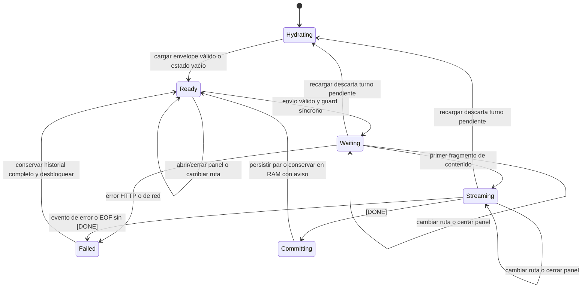
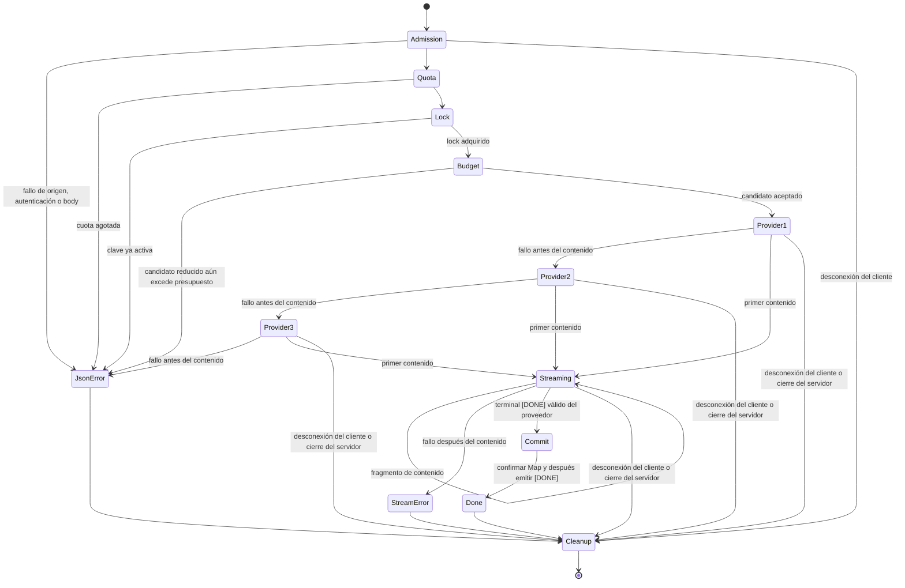

# CHATBOT_SPEC.md

**Capacidad:** `chatbot-tecnico`

**Referencia de cambio prevista:** `agrega-chatbot-tecnico`

**Estado:** borrador técnico consultivo para revisión humana — FASE1.

**Naturaleza:** especificación de comportamiento y diseño; no constituye un change persistido, una implementación ni una declaración de planificación completa.

**Idioma de la experiencia:** español.

## Purpose

Incorporar a BlogDPC un asistente técnico sobre ISAC, redes perceptivas 6G y los siete módulos del proyecto. El asistente ofrecerá respuestas incrementales en español, con Markdown y fórmulas LaTeX, exclusivamente a usuarios autenticados.

La experiencia conservará los turnos completados dentro de la pestaña mediante `window.sessionStorage`. El servidor mantendrá contexto conversacional temporal en memoria, separado por usuario autenticado y sesión de pestaña.

La solución aprovechará la arquitectura existente: React, Express, contratos Zod compartidos, autenticación mediante cookies HttpOnly y despliegue de un solo proceso en Koyeb.

## Scope

### In scope

- Launcher y panel global de conversación.
- Acceso autenticado mediante la sesión existente.
- Un endpoint `POST /api/chat`.
- Streaming de texto mediante SSE sobre `fetch`.
- Markdown y LaTeX con renderizado seguro.
- Historial de turnos completos en `sessionStorage`.
- Contexto temporal en RAM del servidor.
- Límite de 10 solicitudes por minuto y usuario.
- Exclusión de solicitudes simultáneas para una misma conversación.
- Rollover del contexto cuando la entrada estimada supere 6000 tokens.
- Pool secuencial de tres modelos, con fallback exclusivamente antes de emitir contenido.
- Integración con el cierre ordenado existente.
- Pruebas deterministas del protocolo y evaluación cualitativa separada del comportamiento del modelo.

### Non-goals

- Persistir conversaciones en PostgreSQL o en otro servicio.
- Leer comentarios del foro.
- RAG, embeddings, bases vectoriales o recuperación documental.
- Herramientas del modelo, ejecución de código o navegación autónoma.
- Cero soporte para adjuntos/imágenes o aislamiento multi-cuenta tras logout en una misma pestaña
- Redis, coordinación multiproceso o cuotas distribuidas.
- Sincronización entre pestañas.
- Borrado seguro del almacenamiento del navegador.
- Rehidratar el contexto del servidor desde el historial del cliente.
- Exportación, reinicio manual de conversación, selector de modelos o analítica.
- Modificar el contenido de los módulos, incorporar un CMS o completar la bitácora.
- Garantizar ausencia de alucinaciones o retención cero en los proveedores.

## Context and compatibility

### Fuentes y puntos de integración

Las siguientes referencias combinan el relevamiento aportado para este encargo con lecturas puntuales de los puntos de integración. Las líneas son anclas del estado relevado, no identificadores estables.

| Fuente | Ancla | Consecuencia para el diseño |
|---|---|---|
| `context.md` | §§4, 7, 9 y 10; líneas 53–59, 99–110, 122–139 | Documenta la exclusión histórica del chatbot, la autenticación transaccional, el origen unificado y el refresh compartido. |
| `openspec/config.yaml` | Líneas 1–6 | Schema `spec-driven`; contenido en español y encabezados estructurales y palabras normativas en inglés. |
| Specs canónicas `autenticacion`, `sesion-web`, `presentacion-frontend`, `modulos-editoriales`, `acceso-datos`, `despliegue` | Lectura completa informada en el relevamiento | Preservar las políticas existentes y limitar la nueva normativa a esta capacidad. |
| `graphify-out/graph.json` | Consulta informada en el relevamiento previo | Contexto de relaciones ya disponible; este borrador no requiere actualizar el grafo. |
| `apps/server/src/auth/module.ts` | `createAuthModule`, línea 69; `authenticateAccessToken`, líneas 321–324 | La autenticación existente verifica el access token; no existe un supuesto middleware global `requireAuth`. |
| `apps/server/src/auth/crypto.ts` | `verifyAccessToken` | Reutilizar la verificación existente, sin introducir otra implementación JWT. |
| `apps/server/src/http/cookies.ts` | `readCookie`, `ACCESS_COOKIE` | Extraer el token de la cookie existente, no de una propiedad inventada de la request. |
| `apps/server/src/forum/routes.ts` | Líneas 23–26 | Referencia del patrón de lectura de cookie y autenticación por ruta; no importar las restricciones editoriales del foro. |
| `apps/server/src/http/middleware.ts` | `requestContext`, líneas 7–26; `requireSameOrigin`, líneas 28–36 | Reutilizar `requestId` y exigir `Origin == APP_ORIGIN` para el POST. |
| `apps/server/src/http/errors.ts` | `AppError`, líneas 4–16; `parseWith`, líneas 18–28; `errorHandler`, líneas 34–68 | Mantener el envelope JSON y `Retry-After`; no delegar errores posteriores al inicio de SSE al manejador JSON. |
| `apps/server/src/app.ts` | `createApp`, línea 20 | Registrar `/api/chat` antes del 404 de `/api`, sin alterar las rutas existentes. |
| `apps/server/src/config.ts` | `loadConfig`, línea 51; `AppConfig` | Añadir dos secretos server-only y validarlos al inicio. |
| `apps/server/src/server.ts` | Manejo de `SIGTERM`, `SIGINT` y cierre forzado a los 8 segundos | Integrar la liberación de intervalos y solicitudes activas sin rediseñar el cierre. |
| `packages/contracts/src/index.ts` | Contratos Zod compartidos | Incorporar el contrato estricto del POST y los tipos compartibles del protocolo. |
| `apps/web/src/App.tsx` | `App`, línea 44 | `SessionProvider` y `BrowserRouter` ya envuelven `AppShell`; no hace falta modificar este archivo. |
| `apps/web/src/components/AppShell.tsx` | `AppShell`, líneas 28–45; `Outlet`, línea 40 | Montar una sola instancia global del controlador del chatbot, fuera de `Outlet`. |
| `apps/web/src/pages/ModulePage.tsx` | Composición de `ModuleLayout` con `key={module.path}`, según relevamiento | No alojar allí el chatbot: el cambio de módulo remonta el layout. |
| `apps/web/src/lib/manifest.ts` | Manifiesto de siete módulos | Fuente de las rutas internas reconocidas por el renderer. |
| `apps/web/src/session/SessionProvider.tsx` | `useSession`; estados y conectividad relevados | Reutilizar los estados `unknown`, `anonymous`, `authenticated`, `unverifiable` y `online`. |
| `apps/web/src/lib/http.ts` | `refreshPromise`, líneas 41–60; `api`, líneas 73–120 | Añadir un seam que devuelva `Response`, conservando la misma renovación single-flight y el contrato JSON de `api`. |
| `apps/web/src/components/Formula.tsx` | Componente existente, según relevamiento | KaTeX ya está instalado; el componente actual no sustituye un parser de Markdown. |
| `apps/web/src/index.css` | Estilos globales existentes | Destino acotado para CSS de KaTeX y estilos del chat cuando sea necesario. |

Las referencias documentales aportadas para el diseño son:

- `/remarkjs/react-markdown`: integración con `remark-math` y `rehype-katex`, HTML crudo deshabilitado por defecto y tratamiento seguro de URLs.
- `/express-rate-limit/express-rate-limit`: documentación consultada para el limiter de autenticación existente; su `MemoryStore` usa ventana fija y no implementa la cuota deslizante estricta del chat.
- `/websites/developers_openai_api_reference`: extracción de `delta.content` y terminal `[DONE]` del protocolo compatible con OpenAI.

Este borrador no acredita disponibilidad comercial, acceso a cuentas ni funcionamiento real de los identificadores de modelo suministrados.

### Desfase documental reconocido

`context.md` y las instrucciones históricas del proyecto excluyen el chatbot y describen módulos inicialmente vacíos. Este encargo autoriza específicamente la nueva capacidad `chatbot-tecnico`; no autoriza modificar contenido editorial ni convertir esa autorización en una revisión general del proyecto.

Existe además un desfase entre la documentación histórica, la spec canónica de módulos y el contenido actual relevado:

- La spec canónica ya contempla contenido editorial, con diferencias respecto del estado multimedia actual.
- El código relevado contiene cinco videos.
- El change `2026-10-14-agrega-explorador-reparto-alfa` está completo pero no archivado.

El prompt del apéndice es la fuente literal autorizada para esta capacidad, incluso donde refleje ese estado más reciente. Este borrador no sincroniza specs canónicas, no archiva otros cambios y no corrige páginas o documentos ajenos.

## Design

### Arquitectura general

```text
Browser
+----------------------------------------------------------+
| AppShell                                                 |
| +------------------------------------------------------+ |
| | ChatWidget: controller mounted once                  | |
| | - useSession                                         | |
| | - completed history + pending turn in RAM             | |
| | - optional panel presentation                        | |
| +--------------+------------------+--------------------+ |
|                |                  |                      |
|        sessionStorage       shared HTTP refresh          |
|        completed pairs      + fetch stream reader        |
+-----------------------------------+----------------------+
                                    |
                           POST /api/chat
                                    |
Express                             v
+----------------------------------------------------------+
| same-origin -> auth users transaction -> strict body      |
| -> user rate limit -> conversation lock                   |
| -> snapshot + budget + provider pool                     |
|                                                          |
| conversations Map   locks Set   active abort controllers  |
|                                                          |
| provider 1 -> provider 2 -> provider 3                     |
|                  sequential fallback before content only |
+----------------------------------------------------------+
                                    |
                          SSE chunks / DONE / error
```

### Inventario de rutas backend y orden de middleware

El inventario existente relevado en `apps/server/src/app.ts` conserva este orden de middleware global: `requestContext` → Helmet → `express.json` con límite de 32 KB → `requireSameOrigin`.

| Orden | Ruta o etapa | Tratamiento |
|---|---|---|
| 1 | `GET /api/health/live` | Ruta de salud existente. |
| 2 | `GET /api/health/ready` | Ruta de disponibilidad existente. |
| 3 | `/api/auth` | `authLimiter` existente por IP: 60 peticiones cada 15 minutos. |
| 4 | `/api/comments` | Rutas existentes del foro. |
| 5 | `/api/admin` | Rutas existentes de administración. |
| 6 | `POST /api/chat` — nueva | Autenticación y cuota deslizante propias; antes del fallback 404 de `/api`. |
| 7 | `/api` — fallback | Respuesta 404 para rutas API no reconocidas. |
| 8 | Estáticos y fallback SPA | Mismo origen, solo si existe la distribución web; ruta por defecto `apps/web/dist`, sobrescribible mediante `WEB_DIST_PATH`. No exige definir esa variable. |
| 9 | `errorHandler` | Manejador final de errores. |

La nueva ruta `/api/chat` no hereda `authLimiter`. Los errores posteriores al inicio de SSE se comunican dentro de SSE y no atraviesan el manejador JSON.

### Archivos existentes con cambios futuros previstos

Esta tabla describe puntos de integración; no constituye una lista de ejecución.

| Archivo existente | Alcance previsto |
|---|---|
| `apps/server/src/app.ts` | Componer el módulo de chat, registrar su ruta y su limiter propio antes del 404 de `/api`. |
| `apps/server/src/config.ts` | Validar `NVIDIA_NIM_API_KEY`, `OPENROUTER_API_KEY` y `GEMINI_API_KEY` como secretos obligatorios del servidor. |
| `apps/server/src/auth/module.ts` | Exponer un helper mínimo que reutilice la verificación del token y reconsulte `users` en una transacción breve. |
| `apps/server/src/server.ts` | Invocar la disposición del módulo de chat durante el cierre existente. |
| `packages/contracts/src/index.ts` | Definir el body estricto y los tipos de los eventos del chat. |
| `apps/web/src/components/AppShell.tsx` | Montar una sola instancia de `ChatWidget` fuera de `Outlet`. |
| `apps/web/src/lib/http.ts` | Compartir el mecanismo de fetch/refresh con una variante que entregue `Response` sin consumir el cuerpo. |
| `apps/web/package.json` | Declarar `react-markdown`, `remark-math` y `rehype-katex`. |
| `pnpm-lock.yaml` | Reflejar exclusivamente la resolución de esas dependencias y sus dependencias transitivas. |
| `apps/web/src/index.css` | Incorporar el CSS de KaTeX requerido por el renderer y estilos acotados del chat, si no están cubiertos por los tokens existentes. |

No se prevén cambios necesarios en:

- `apps/web/src/App.tsx`.
- `ModulePage.tsx` ni `ModuleLayout`.
- Esquema o migraciones de PostgreSQL.
- Rutas, políticas o contenido del foro.
- Páginas de los siete módulos.
- Specs canónicas.
- Archivos del grafo.

No se presupone que exista `.env.example`. No se requiere leer el `.env` real para redactar o verificar esta especificación.

### Archivos nuevos propuestos

| Archivo propuesto | Responsabilidad |
|---|---|
| `apps/server/src/chat/module.ts` | Estado en RAM, locks, presupuesto, selección secuencial de proveedor, commit y disposición. |
| `apps/server/src/chat/routes.ts` | Adaptación HTTP: cookie, auth, validación, cuota, respuesta JSON previa o SSE posterior. |
| `apps/server/src/chat/provider.ts` | Fetch compatible con OpenAI, parser incremental upstream, TTFB, cancelación y extracción de texto. |
| `apps/server/src/chat/prompt.ts` | Constante con el prompt literal completo del apéndice. |
| `apps/web/src/components/chat/ChatWidget.tsx` | Controlador global, estados de envío, launcher, panel y formulario. |
| `apps/web/src/components/chat/ChatMessage.tsx` | Render seguro de texto, Markdown, fórmulas y enlaces. |
| `apps/web/src/chat/session.ts` | UUID de pestaña, validación del envelope y persistencia tolerante a fallos. |
| `apps/web/src/chat/stream.ts` | Consumo incremental de SSE y validación de eventos. |

No se propone fragmentar adicionalmente la capacidad en múltiples stores, providers o capas de infraestructura.

### Dependencias y presentación

El frontend relevado utiliza React 19.2.8, React Router 7.18.4, Tailwind 4.3.3, `tw-animate-css`, Inter local, componentes Radix/UI y Lucide 1.47.0. KaTeX 0.18.7 ya está instalado.

Se propone añadir únicamente estas dependencias de renderizado:

- `react-markdown`.
- `remark-math`.
- `rehype-katex`.

No se requiere un SDK de LLM.

El renderer de Markdown mantendrá deshabilitado el HTML crudo. No incorporará `rehype-raw` ni reemplazará la transformación segura de URLs por una función permisiva.

Para las fórmulas se usará KaTeX con `trust: false`. El renderer Markdown podrá producir `htmlAndMathml`; en ese caso se cargará explícitamente el CSS de KaTeX. El comportamiento existente de `Formula.tsx`, que usa salida MathML, no debe cambiarse globalmente para acomodar el chat.

Durante streaming, delimitadores o expresiones incompletas se mostrarán como texto seguro cuando todavía no puedan renderizarse. Un error de fórmula no debe derribar el panel ni la página.

### Autenticación y autorización

El flujo de autenticación será:

1. Leer `ACCESS_COOKIE` mediante `readCookie`.
2. Reutilizar `authenticateAccessToken` y, por esa vía, `verifyAccessToken`.
3. Obtener el identificador real desde `claims.sub`.
4. Abrir una transacción breve.
5. Consultar la existencia del usuario en `users` dentro de esa transacción.
6. Cerrar la transacción antes de crear una solicitud al proveedor.

El helper nuevo se alojará en el módulo de autenticación existente. No se presupone `request.userId`, un middleware `requireAuth` ni otra infraestructura que no exista.

La política de esta capacidad exige autenticación, no permiso para publicar en el foro:

- `USER` y `ADMIN` pueden usarla.
- No se exige correo verificado.
- `isBanned` no se convierte en una prohibición de chat: la suspensión relevada restringe publicar en el foro.
- No se consultan comentarios ni se reutilizan joins o reglas del foro.

El `userId` queda fijado para toda la solicitud admitida. Un cambio posterior de sesión del navegador no reasigna el stream a otra cuenta.

### Contrato HTTP del navegador

#### Request

**Método y ruta:** `POST /api/chat`

**Autenticación:** cookies existentes, con `credentials: "same-origin"`.

**Content-Type:** `application/json`.

**Origin:** exactamente `APP_ORIGIN`.

Ejemplo válido:

```json
{
  "tabSessionId": "9f2bc948-76a0-4dd2-8f4e-e22bdb47f457",
  "message": "¿Cómo depende la resolución de rango del ancho de banda?"
}
```

El body contiene exclusivamente:

| Campo | Regla |
|---|---|
| `tabSessionId` | String UUID versión 4, con variante válida. |
| `message` | String no vacío y no compuesto únicamente por espacios; máximo 300 unidades UTF-16 según `.length` de JavaScript. |

Reglas de validación:

- El objeto Zod es estricto.
- Se rechazan propiedades adicionales, incluido `history`.
- El límite de 300 se aplica al texto original antes de cualquier comprobación con `trim()`.
- `trim()` se utiliza para detectar un mensaje formado únicamente por espacios.
- El contenido aceptado se conserva sin un recorte silencioso que altere su longitud o significado.
- Frontend y backend usan el mismo criterio de longitud.
- Un emoji representado por un par sustituto cuenta como dos unidades UTF-16.
- El frontend no limita pegados mediante truncamiento silencioso: muestra el límite y evita el envío inválido.
- Se conserva el parser JSON global de 32 KB; no se aumenta su límite para el chat.

El cliente no envía:

- Historial.
- `userId`, rol o datos de perfil.
- Prompt de sistema.
- Modelo o proveedor.
- Parámetros de generación.
- Adjuntos.

#### Orden de admisión

El orden efectivo es:

1. Middleware global existente, incluido `requestContext`, seguridad, parser JSON y comprobación de origen.
2. Autenticación y consulta transaccional de usuario.
3. Validación estricta del body.
4. Limiter por `userId`.
5. Adquisición del lock de conversación.
6. Snapshot y presupuesto de contexto.
7. Solicitud al primer proveedor.

Un JSON sintácticamente inválido se rechaza en el parser global antes de llegar a las validaciones específicas del chat.

#### Respuesta exitosa

```http
HTTP/1.1 200 OK
Content-Type: text/event-stream; charset=utf-8
Cache-Control: no-store, no-transform
X-Accel-Buffering: no
```

`X-Accel-Buffering: no` es una indicación para proxies compatibles, no una garantía sobre Koyeb o toda infraestructura intermedia.

Los encabezados SSE se difieren hasta disponer del primer fragmento de contenido no vacío. No se ejecuta un flush anticipado de headers que impida responder con un error JSON si fallan los tres proveedores antes de generar texto.

#### Eventos SSE de salida

Cada frame termina con dos caracteres LF. Los datos se serializan mediante `JSON.stringify`; saltos de línea, comillas y barras del contenido se escapan dentro del JSON.

Fragmento de texto:

```text
data: {"chunk":"La resolución de rango depende del ancho de banda."}

```

Terminación exitosa:

```text
data: [DONE]

```

Interrupción después de iniciado el contenido:

```text
event: error
data: {"error":{"code":"CHAT_STREAM_INTERRUPTED","message":"La respuesta se interrumpió. Intenta de nuevo."},"requestId":"f2a52a0d-688f-4c8a-b91e-e8044a19c89d"}

```

Los frames anteriores equivalen, respectivamente, a:

- `data: {"chunk":"..."}\n\n`
- `data: [DONE]\n\n`
- `event: error\ndata: {...}\n\n`

Después de un evento de error:

- Se cierra el stream.
- No se emite `[DONE]`.
- No se cambia el status HTTP.
- No se escribe un envelope JSON fuera del protocolo SSE.

### Errores y recuperación

Antes de iniciar SSE se conserva el envelope existente:

```json
{
  "error": {
    "code": "CHAT_UNAVAILABLE",
    "message": "El asistente no está disponible en este momento. Intenta de nuevo."
  },
  "requestId": "f2a52a0d-688f-4c8a-b91e-e8044a19c89d"
}
```

| Situación | HTTP o canal | Código | Comportamiento |
|---|---|---|---|
| JSON inválido | HTTP 400 JSON | `INVALID_JSON` | Mensaje del manejador existente. |
| Body incompatible, UUID incorrecto, texto vacío, exceso de longitud o campos extra | HTTP 400 JSON | `VALIDATION_ERROR` | `parseWith`; `fieldErrors` cuando corresponda. |
| Cookie ausente | HTTP 401 JSON | `AUTH_REQUIRED` | No se consulta el proveedor. |
| Token inválido o vencido | HTTP 401 JSON | Código vigente de verificación de autenticación | Se conserva la semántica de auth existente. |
| Token verificable sin usuario existente | HTTP 401 JSON | `AUTH_REQUIRED` | El helper no autoriza únicamente por el JWT. |
| `Origin` ausente o distinto | HTTP 403 JSON | `INVALID_ORIGIN` | No se consulta el proveedor. |
| Cuota agotada | HTTP 429 JSON | `CHAT_RATE_LIMITED` | Incluye `Retry-After` y `error.retryAfterSeconds`. |
| Otra solicitud activa para la misma clave | HTTP 409 JSON | `CHAT_IN_PROGRESS` | No se inicia otro proveedor ni se serializan todos los usuarios. |
| El contexto sigue excediendo 6000 tras el rollover | HTTP 422 JSON | `CHAT_CONTEXT_TOO_LARGE` | No se recorta el prompt ni el último par; no se llama al proveedor. |
| Los tres intentos fallan antes del contenido | HTTP 503 JSON | `CHAT_UNAVAILABLE` | Mensaje genérico; sin cuerpos upstream. |
| Fallo después del primer fragmento | SSE sobre HTTP 200 | `CHAT_STREAM_INTERRUPTED` | Evento de error y cierre; sin fallback ni commit del turno. |
| Desconexión del cliente | Cierre de transporte | Sin respuesta adicional obligatoria | Se aborta el proveedor y se liberan recursos. |
| Excepción interna previa al stream | HTTP 500 JSON | `INTERNAL_ERROR` | Se conserva el manejador existente, sin datos sensibles. |
| HTTP 200 sin body o sin Content-Type SSE válido | Fallo local del cliente | No requiere nuevo código HTTP | No se persiste el turno; se informa el fallo y se desbloquea. |
| EOF sin `[DONE]` en el cliente | Fallo local del cliente | No requiere nuevo código HTTP | La respuesta no se considera completada. |

Los códigos `CHAT_*` de la tabla son parte del contrato propuesto de esta capacidad.

`Retry-After` será un número entero de segundos coherente con el tiempo restante de la ventana, redondeado hacia arriba para no recomendar un reintento anticipado.

Los errores upstream HTTP 401, 403 o 429 no se transmiten como si fueran errores de sesión, origen o cuota del usuario de BlogDPC. Son fallos del intento de proveedor y siguen la política de fallback.

### Cuota y concurrencia

El sistema SHALL admitir como máximo 10 peticiones por `userId` en los últimos 60 000 ms mediante una ventana deslizante en RAM. No usa ventanas fijas, que permitirían hasta 20 admisiones alrededor de una frontera. Un `Map<string, number[]>` separado del Map de conversaciones conserva como máximo 10 timestamps por usuario. Tras auth y validación estricta, y antes de lock/presupuesto, se obtiene `now = Date.now()`, se eliminan timestamps `t <= now - 60000` y, sin esperas asíncronas intermedias, se rechaza con 429 `CHAT_RATE_LIMITED` si quedan 10 (la 11.ª petición se rechaza); en otro caso se registra `now`. La ventana es `(now - 60000, now]`; cumplir exactamente 60 000 ms libera cupo, sin reset global. Las rechazadas por cuota no se registran. En rechazo, `retryAfterSeconds = Math.ceil((oldest + 60000 - now) / 1000)` y el mismo entero se incluye en `Retry-After` y `error.retryAfterSeconds`.

Las admitidas consumen cuota aunque luego fallen upstream, reciban 409, excedan contexto o se desconecten. Los intentos del pool son una sola petición y no añaden timestamps. Origen/auth/body inválidos no consumen esta cuota. No hay cuotas adicionales por IP o pestaña. El barrido existente de cinco minutos poda también timestamps vencidos y elimina contadores vacíos; dispose vacía contadores sin añadir otro intervalo ni modificar el Map de conversaciones.

La cuota del chat usa estructuras nativas RAM, sin dependencia nueva. `express-rate-limit` sigue en el limiter de autenticación; su MemoryStore fijo no satisface esta ventana estricta y no se reutiliza para chat.

La concurrencia por conversación se controla mediante un `Set<string>` separado del Map de historiales. La clave es la misma que la conversación. La adquisición debe realizarse sin un punto de espera entre comprobar y registrar el lock dentro del proceso.

El lock se libera en todos los caminos terminales mediante limpieza garantizada. Conversaciones de otras claves no quedan bloqueadas por él.

### Estado del servidor

La estructura de conversación es exactamente:

```text
Map<string, {
  messages: Array<{ role: string, content: string }>,
  lastActive: number
}>
```

La clave es:

```text
${userId}:${tabSessionId}
```

Invariantes:

- `messages` contiene únicamente pares completos `user` / `assistant`.
- El orden es alternado y comienza por `user`.
- No se almacena el mensaje `system`.
- El turno pendiente vive en variables locales de la solicitud.
- La acumulación de la respuesta pendiente no modifica `messages`.
- El Map no se consulta ni persiste en PostgreSQL.
- Locks y controladores de aborto se mantienen en estructuras separadas.

Cuando no existe una clave, se parte de una conversación vacía. Puede registrarse un contenedor vacío para su actividad, pero no se agrega el mensaje pendiente al historial.

La inexistencia puede deberse a una pestaña nueva, expiración o reinicio del proceso. En todos esos casos se inicia contexto nuevo silenciosamente, sin solicitar ni aceptar la historia del navegador.

#### Actividad y TTL

`lastActive` se expresa como timestamp de `Date.now()` y se actualiza:

- Al admitir una solicitud válida, dentro de cuota y con lock adquirido.
- Al procesar fragmentos de texto no vacíos de la respuesta activa.
- Al confirmar un turno exitoso.

Headers, comentarios SSE, eventos de rol y metadatos sin contenido no prolongan por sí solos la actividad.

Un `setInterval` cada cinco minutos elimina las entradas que satisfacen:

```text
Date.now() - lastActive > 30 * 60 * 1000
```

Consecuencias:

- A exactamente 30 minutos no se elimina la entrada.
- La eliminación ocurre en una pasada del intervalo, no necesariamente al cruzar el minuto 30.
- El intervalo se marca con `unref()`.
- La disposición del módulo lo cancela.
- Las pruebas pueden controlar el reloj y disponer el módulo sin dejar handles activos.

La limpieza del Map no elimina un lock de una solicitud aún activa. Si una entrada caduca durante una espera excepcionalmente larga, el snapshot local del turno sigue siendo local. Un éxito posterior puede volver a registrar el contexto confirmado con actividad actual; un fallo no restaura una entrada que ya fue eliminada por TTL.

La expiración y el reinicio pueden producir una diferencia entre la historia visible del cliente y el contexto disponible para el modelo. No se oculta esta limitación mediante una rehidratación implícita.

### Presupuesto de entrada y rollover

El presupuesto se calcula antes de llamar a cualquier proveedor:

```text
tokensEstimados =
  (
    longitudDelPromptLiteral
    + sumaDeLongitudesDeContentsDelHistorial
    + longitudDelNuevoMensaje
  ) / 4
```

Para que el cálculo sea reproducible en JavaScript, las longitudes usan `.length`, es decir, unidades UTF-16. Es una aproximación, no un tokenizer del proveedor.

No se redondea antes de comparar:

- `tokensEstimados == 6000`: se admite sin rollover.
- `tokensEstimados > 6000`: se aplica rollover.
- Una estimación fraccionaria mayor que 6000 también supera el límite.

El presupuesto es exclusivamente de entrada. No se reservan 700 tokens dentro de él y no se sustituye por un umbral de 5300.

Algoritmo conceptual:

1. Obtener un snapshot del historial completo confirmado.
2. Calcular la estimación con el prompt literal y el nuevo mensaje.
3. Si no supera 6000, usar el snapshot completo.
4. Si supera 6000, construir un candidato conservando exactamente el último par completo `user` / `assistant`.
5. Si no existe ningún par, el candidato conserva cero mensajes anteriores.
6. Añadir el nuevo mensaje solo al payload local.
7. Recalcular con el prompt, el puente conservado y el nuevo mensaje.
8. Si todavía supera 6000, responder `CHAT_CONTEXT_TOO_LARGE` sin llamar al proveedor.

No se permite:

- Resumir el historial.
- Recortar el prompt.
- Recortar el último par.
- Mantener una cola FIFO mediante eliminación continua de mensajes individuales.
- Separar un par.
- Alterar la historia visual del navegador por el rollover del servidor.

Con un único par previo, el rollover conserva ese mismo par; si sigue sin caber, el resultado es el error de presupuesto.

El historial candidato solo sustituye `messages` al confirmar la respuesta completa. Un fallo no aplica el rollover al historial original. Las actualizaciones de `lastActive` no se consideran un commit de contenido.

Después de añadir la salida exitosa, la memoria puede volver a representar más de 6000 tokens estimados. El presupuesto vuelve a evaluarse en la siguiente entrada.

### Contrato upstream y pool de modelos

Cada intento realiza un POST compatible con OpenAI con exactamente estos campos funcionales:

| Campo | Valor |
|---|---|
| `model` | Identificador de la fila correspondiente del pool. |
| `messages` | Primer mensaje `system` con el apéndice literal completo; después el historial candidato; finalmente el nuevo mensaje `user`. |
| `stream` | `true`. |
| `max_tokens` | `16384` para NVIDIA NIM; `700` para OpenRouter y Gemini. |
| `chat_template_kwargs` | `{ "enable_thinking": true }` para NVIDIA NIM; omitido para los demás. |

Se envían `Content-Type: application/json` y autenticación Bearer con el secreto del servidor correspondiente.

No se incluyen herramientas, imágenes, datos de perfil, cookies, identificadores de usuario, IP ni `tabSessionId`.

| Orden | Modelo | Endpoint | Secreto | TTFB de contenido |
|---|---|---|---|---:|
| 1 | `nvidia/nemotron-3.5-super-vl-120b-a12b` | `https://integrate.api.nvidia.com/v1/chat/completions` | `NVIDIA_NIM_API_KEY` | 15000 ms |
| 2 | `nvidia/nemotron-3.5-lightning:free` | `https://openrouter.ai/api/v1/chat/completions` | `OPENROUTER_API_KEY` | 20000 ms |
| 3 | `gemini-3.1-flash-lite` | `https://generativelanguage.googleapis.com/v1beta/openai/chat/completions` | `GEMINI_API_KEY` | 10000 ms |

Los modelos se intentan secuencialmente, como máximo una vez cada uno por solicitud. No hay llamadas paralelas ni reintentos del mismo modelo.

Los nombres se consideran suministrados por el encargo. Su existencia, permisos, disponibilidad y cuotas requieren verificación operativa posterior; no se afirman verificados en este borrador.

### TTFB, fallback y extracción de contenido

Cada intento tiene su propio `AbortController`.

El timer comienza inmediatamente antes de iniciar `fetch` y finaliza al recibir el primer `delta.content` que sea un string no vacío o el primer token de razonamiento no vacío (`delta.reasoning_content` o `delta.reasoning`).

La recepción de razonamiento no vacío cancela el timer de TTFB para permitir el proceso de pensamiento del modelo, pero el contenido del razonamiento nunca se emite en el stream del cliente (`onChunk`) ni se almacena en la respuesta final del asistente.

No satisfacen ese requisito:

- Recepción de headers HTTP.
- Apertura de conexión.
- Comentarios o keep-alives SSE.
- Delta de rol.
- `delta.content` vacío.
- Metadatos.
- Tool calls.

Solo se extrae texto de contenido (`delta.content`) de la respuesta conversacional; los campos de razonamiento y ajenos se ignoran para el stream downstream. No se retransmiten mensajes upstream arbitrarios.

Antes de escribir el primer frame de contenido al cliente, las siguientes situaciones cancelan el intento y habilitan el siguiente modelo:

- HTTP 4xx o 5xx.
- Error de red.
- Vencimiento del timer.
- Body ausente.
- Respuesta o evento upstream inválido.
- Terminal sin contenido.
- EOF prematuro o sin terminal válido.

La cancelación libera el reader, timer y recursos del intento anterior. No deben quedar respuestas tardías capaces de emitir texto después de cambiar de modelo.

La frontera que impide el fallback se alcanza al comenzar la emisión del primer frame de contenido al cliente. No se supone que el servidor pueda comprobar la recepción efectiva de esos bytes por el navegador.

Después de esa frontera:

- Cualquier fallo termina en interrupción.
- No se intenta otro modelo.
- No se repite el actual.
- No se añade el par al Map.
- Se emite el evento de error si la conexión sigue siendo escribible.

Los 15000 + 20000 + 10000 ms representan presupuestos de espera de contenido por intento. No constituyen un SLO total de 45 segundos: existen tiempos de cancelación, procesamiento, escritura y generación posterior.

No se introduce un timeout total ni un timeout entre chunks después del primer contenido.

### Terminación y atomicidad del turno

Un turno es exitoso cuando:

- Se recibió contenido no vacío.
- El stream upstream alcanzó un terminal válido `[DONE]`.
- No se detectó un fallo de transporte o protocolo previo al commit.

Un `finish_reason` de `stop` o `length` no convierte por sí mismo el turno en fallo si el protocolo termina correctamente. Alcanzar el límite de salida de 700 tokens puede producir una respuesta semánticamente incompleta, pero transportada con éxito.

El orden de confirmación del servidor es:

1. Validar la terminación upstream.
2. Formar el par completo `user` / `assistant`.
3. Confirmar en el Map el historial candidato más ese par.
4. Actualizar `lastActive`.
5. Emitir `[DONE]` al cliente.
6. Finalizar la respuesta y liberar recursos.

El cliente:

- Acumula el turno pendiente solo en RAM.
- Confirma visualmente el turno completo y actualiza el historial persistible al recibir `[DONE]`.
- Persiste conjuntamente los dos mensajes del par.
- No considera un EOF como sustituto de `[DONE]`.
- No persiste un turno interrumpido.

No hay una transacción distribuida entre Map, socket y `sessionStorage`.

Existe una ventana inevitable: el servidor puede confirmar el par y el cliente no recibir `[DONE]`. En ese caso el servidor conserva contexto que el navegador no ha confirmado. No se añade ACK, replay, idempotency key ni reconciliación automática para resolverla.

Un reenvío manual posterior es una solicitud nueva y puede consumir cuota y contexto adicionales.

### Desconexión y cierre

Si el cliente se desconecta antes de la confirmación:

- Se aborta la solicitud upstream activa.
- Se cancela su reader.
- Se limpian timers.
- Se libera el lock.
- Se descarta el turno pendiente.
- No se intenta un proveedor de respaldo.

La detección de cierre debe distinguir un cierre prematuro de la respuesta de la finalización normal de la lectura del body de request. No debe abortarse una generación válida simplemente porque el POST ya terminó de recibirse.

El cierre del módulo:

- Cancela el intervalo de TTL.
- Aborta solicitudes upstream activas.
- Permite ejecutar las limpiezas de cada solicitud.
- No persiste el Map.
- Se integra con el manejo actual de `SIGTERM` y `SIGINT`.
- No amplía ni sustituye el cierre forzado existente de ocho segundos.

Un reinicio pierde historiales, locks y contadores en RAM. El navegador conserva únicamente lo que su `sessionStorage` conserve.

### Estado y persistencia del navegador

Se utiliza una única clave:

```text
blogdpc.chat.v1
```

Envelope:

```json
{
  "tabSessionId": "9f2bc948-76a0-4dd2-8f4e-e22bdb47f457",
  "messages": [
    {
      "role": "user",
      "content": "¿Qué significa ISAC?",
      "status": "completed"
    },
    {
      "role": "assistant",
      "content": "ISAC integra comunicaciones y percepción utilizando recursos compartidos.",
      "status": "completed"
    }
  ]
}
```

No se añade un campo `version`: el namespace de la clave ya identifica la versión del envelope.

Reglas:

- Si no existe un envelope válido, se genera un UUIDv4 para esa sesión de almacenamiento.
- Se valida el UUID, el shape, los roles, los contenidos, los estados y la alternancia en pares.
- Solo se persisten pares completos.
- El mensaje pendiente y la respuesta parcial permanecen en RAM.
- La actualización del envelope utiliza una sola escritura con el historial confirmado completo.
- No se utiliza `localStorage`.
- No se usa `BroadcastChannel`.
- No se cambia ni se borra el envelope al cerrar sesión.
- No se rota el UUID por cambiar de cuenta.

Si se recarga la pestaña durante una respuesta, el turno pendiente completo —usuario y asistente— se descarta. Se restauran únicamente los pares que ya estaban confirmados.

Si el envelope está corrupto, la capacidad se recupera con estado vacío sin impedir que cargue el blog. Puede reemplazarse el valor corrupto si el almacenamiento está disponible.

Si acceder o escribir en `sessionStorage` produce `SecurityError`, cuota agotada u otro error de almacenamiento:

- La conversación continúa en RAM.
- Se muestra un aviso no bloqueante.
- No se borran los turnos de RAM por el fallo de persistencia.
- No se promete recuperar en F5 los turnos no almacenados.
- La persistencia no se considera un requisito para poder conversar durante esa instancia de página.

La conservación de `sessionStorage` depende del navegador:

- Una recarga ordinaria conserva normalmente el almacenamiento.
- El cierre ordinario de la sesión de pestaña lo elimina conforme al comportamiento nativo.
- La restauración del navegador puede restaurarlo.
- Una pestaña duplicada o creada con `opener` puede recibir una copia.
- No se promete UUID exclusivo entre clones ni borrado seguro.

Si dos pestañas comparten una copia del UUID y usan la misma cuenta, pueden dirigirse a la misma clave del servidor. El lock backend sigue protegiendo esa clave; no se introduce coordinación adicional entre pestañas.

### Identidad y riesgo de multicuenta

La separación backend usa el usuario real, no la identidad declarada por el cliente:

| Caso | Historia visual del navegador | Contexto backend |
|---|---|---|
| Mismo usuario y mismo `tabSessionId` | Historia de la pestaña | Misma clave mientras exista. |
| Mismo usuario y UUID distintos | Historias independientes en condiciones ordinarias | Claves distintas. |
| Usuarios distintos y mismo UUID | Puede compartirse visualmente al reutilizar la pestaña | Claves distintas. |
| Misma cuenta y pestaña clonada con UUID copiado | Copia inicial que luego puede divergir | Puede coincidir la clave. |

El logout no limpia el historial visual. Una cuenta posterior en la misma pestaña puede leer mensajes de la anterior. Esta ausencia de aislamiento local es una limitación aceptada y debe advertirse en la experiencia.

El payload hacia el proveedor no lleva identidad explícita; eso no impide que un usuario escriba datos personales en el texto. No se promete anonimización semántica del contenido.

### Integración con React y navegación

`ChatWidget` se monta una sola vez dentro de `AppShell`, fuera de `Outlet`.

No recibe una `key` derivada de:

- La ruta.
- El módulo.
- El usuario.
- La apertura o cierre del panel.

El controlador permanece montado aunque la presentación del panel esté cerrada. Un portal o contenido visual del panel puede desmontarse si los componentes UI lo requieren, pero no el dueño del estado, el reader ni la solicitud activa.

Durante una generación:

- Navegar entre las siete rutas no reinicia el historial ni el stream.
- Cerrar el panel no aborta.
- Abrirlo vuelve a mostrar el estado actual.
- No se instala la capacidad en `ModuleLayout`.

El estado `isStreaming` se activa desde la aceptación del envío, incluyendo la espera inicial y un eventual refresh. Se aplica un guard síncrono antes del siguiente render para impedir doble envío por clic, Enter o eventos próximos.

Mientras `isStreaming === true`, tanto el campo de entrada como el botón de envío SHALL tener su propiedad nativa `disabled` en `true`. Este bloqueo abarca la aceptación del envío, la renovación compartida, la espera del primer contenido y todo el streaming; solo se libera tras `[DONE]`, error terminal o aborto, conservando los demás impedimentos de sesión, red o validación. El guard síncrono evita envíos duplicados antes del rerender, pero no sustituye deshabilitar ambos controles.

### Sesión web y seam HTTP

La habilitación del envío requiere:

```text
status == authenticated
AND online == true
AND isStreaming == false
AND message is valid
```

Comportamiento por estado:

| Estado | Comportamiento |
|---|---|
| `anonymous` | Mostrar CTA hacia `/login`; no enviar POST al chat. |
| `unknown` | Bloquear envío mientras se determina la sesión. |
| `unverifiable` | Bloquear envío; conservar lectura del historial y no declarar logout por un fallo de red. |
| Offline | Bloquear nuevos envíos; conservar historia. |
| `authenticated` y online | Permitir envío si el texto es válido y no existe turno activo. |

Una interrupción de red de un stream activo se trata como fallo de ese turno, no como orden de borrar el historial.

La función actual `api` consume JSON y no sirve directamente para SSE. Se propone un seam mínimo, por ejemplo `apiResponse`, que:

- Devuelva un `Response` sin consumir su body exitoso.
- Use cookies same-origin.
- Comparta exactamente la misma `refreshPromise` y notificaciones de sesión que `api`.
- Preserve la firma y el comportamiento JSON públicos de `api`.

Ante un HTTP 401 previo al stream:

1. Se utiliza la renovación compartida.
2. Si es exitosa, se repite el POST una sola vez.
3. Un segundo 401 no inicia otra renovación para esa misma operación.
4. Un refresh no verificable no destruye la sesión local ni el historial.

No se crea un circuito de refresh exclusivo del chat.

No se autorreproduce una solicitud por error de red, EOF, respuesta parcial o error SSE. Después de iniciado el stream no existe un refresh/replay automático.

### Parser SSE del navegador y del proveedor

La lectura se basa en:

- `fetch`.
- `Response.body.getReader()`.
- `TextDecoder` con modo streaming.
- Buffer incremental de texto y separación de eventos.

El parser no asume que:

- Un chunk de red sea un frame SSE.
- Un frame tenga un único chunk de red.
- Los caracteres UTF-8 lleguen completos.
- Todos los saltos de línea sean LF.
- Un evento venga aislado de los siguientes.

Debe soportar:

- LF y CRLF, incluso partidos entre lecturas.
- Eventos divididos en múltiples lecturas.
- Varios eventos en una lectura.
- Caracteres multibyte divididos entre lecturas.
- Comentarios SSE.
- Campos `event` y `data`.
- La composición de líneas `data` conforme al formato SSE.

El cliente acepta como eventos de negocio:

- Datos JSON con un `chunk` string.
- `[DONE]`.
- `event: error` con el envelope definido.

Un evento malformado del protocolo de negocio produce un fallo controlado; no se interpreta como HTML ni como texto arbitrario del asistente.

Al terminar, fallar o abortar, se libera el reader y se desbloquea el envío. Un cierre sin `[DONE]` no confirma el par.

### UI y accesibilidad

La interfaz mínima incluye:

- Launcher con nombre accesible.
- Panel con título identificable.
- Historial.
- Campo de texto con label.
- Contador o indicación del límite de 300.
- Botón de envío.
- Control de cierre.
- Estados de espera, generación, error y persistencia degradada.
- CTA de acceso cuando corresponda.

Requisitos visuales y de interacción:

- Controles principales con área de interacción mínima de 44 × 44 CSS px.
- Uso de tokens, tipografía y componentes existentes.
- Foco visible.
- Apertura y cierre por teclado.
- Escape cierra el panel.
- Al cerrar se restaura el foco al launcher.
- Manejo de foco acorde con la semántica del panel/Sheet utilizado.
- `aria-live` para cambios de estado relevantes, no para anunciar cada token.
- Pruebas a 360, 768 y 1440 CSS px.
- Respeto de `prefers-reduced-motion`.
- Fórmulas y bloques anchos contenidos dentro del panel sin provocar desbordamiento horizontal de toda la página.

No se incorporan controles de exportación, reset, adjuntos, selección de modelo ni analítica.

Los turnos fallidos pueden mostrarse transitoriamente como no completados, pero no se incorporan al envelope persistido ni al historial futuro enviado por el servidor. Cualquier nuevo envío requiere una acción explícita del usuario.

### Markdown, enlaces y contenido no confiable

Tanto los mensajes del usuario como la salida del modelo se consideran no confiables.

El renderer:

- No ejecuta HTML crudo.
- No usa `dangerouslySetInnerHTML` con la salida del modelo.
- No carga imágenes remotas.
- No habilita protocolos de URL inseguros.
- No habilita capacidades confiables de KaTeX.
- Trata fallos y fragmentos LaTeX incompletos como texto seguro o error de presentación localizado.

Los enlaces a las siete rutas editoriales se renderizan mediante el router, sin recarga completa:

- `/planeacion`
- `/analisis`
- `/tendencias`
- `/mini-caso`
- `/divulgacion`
- `/bitacora`
- `/glosario`

Los destinos ajenos a esa conversión conservan la política segura de URLs del renderer; no se transforman arbitrariamente en navegación interna ni en ejecución de recursos.

### Seguridad, privacidad y observabilidad

La única comunicación del módulo de chat con datos persistentes es la consulta de `users` necesaria para autenticación.

No hay:

- Tabla de conversaciones.
- Escritura de prompts o respuestas en DB.
- Acceso a `comments`.
- Herramientas que permitan al modelo consultar datos.
- Fetch de contenido del foro.
- Recuperación de páginas para enriquecer el prompt.

La entrada al proveedor contiene exclusivamente el prompt literal y textos conversacionales.

Los logs no incluyen:

- Secrets o headers Bearer.
- Cookies.
- Prompt de sistema completo.
- Texto de usuario.
- Texto de respuesta.
- Cuerpos de error upstream.

Pueden conservar metadatos operativos no sensibles como `requestId`, código genérico, duración o intento/modelo. Las excepciones upstream se convierten en errores sanitizados antes de alcanzar el logger del manejador global, que registra el mensaje de la excepción.

El prompt orienta el dominio y el formato, pero no es un sandbox ni una garantía absoluta contra prompt injection o alucinaciones. La ausencia técnica de herramientas y acceso a comentarios es independiente del cumplimiento del prompt.

No almacenar chats en BlogDPC no equivale a que los proveedores no los procesen o retengan. Esa retención depende de sus condiciones y configuración operativa.

### Configuración

Se agregan exclusivamente estas tres variables server-only:

| Variable | Regla |
|---|---|
| `NVIDIA_NIM_API_KEY` | String no vacío; obligatoria al cargar configuración. |
| `OPENROUTER_API_KEY` | String no vacío; obligatoria al cargar configuración. |
| `GEMINI_API_KEY` | String no vacío; obligatoria al cargar configuración. |

Todas se validan mediante el mecanismo Zod de `loadConfig`, con fallo temprano si faltan. No se exponen con prefijo `VITE_`, en contratos públicos ni en el bundle.

Los modelos, endpoints, TTFB y límites de esta especificación son constantes de esta capacidad, no nuevos parámetros configurables.

Se preservan las variables existentes:

`PORT`, `APP_ORIGIN`, `DATABASE_URL`, `DATABASE_SSL`, `DATABASE_PREPARE`, `DB_MAX_CONNECTIONS`, `JWT_ACCESS_SECRET`, `COOKIE_SECURE`, `TRUST_PROXY_HOPS`, `SMTP_HOST`, `SMTP_PORT`, `SMTP_USER`, `SMTP_APP_PASSWORD`, `MAIL_FROM`, `GOOGLE_CLIENT_ID`, `GOOGLE_CLIENT_SECRET`, `GOOGLE_REDIRECT_URI` y `WEB_DIST_PATH`.

`DATABASE_MIGRATION_URL` continúa perteneciendo a los scripts de migración; el chat no la utiliza.

### Client state machine

La elegibilidad por autenticación y conectividad es una condición ortogonal. No borra el estado conversacional.



### Server state machine



## Acceptance and verification

### Matriz de aceptación determinista

| ID | Criterio verificable |
|---|---|
| A01 | En los tres intentos, primer mensaje `system` idéntico al literal, orden correcto de mensajes, `stream: true` y `max_tokens: 700`. |
| A02 | Cookie ausente, token inválido y usuario inexistente producen 401 sin llamada LLM. |
| A03 | La lectura de `users` ocurre dentro de una transacción; el proveedor comienza después de cerrarla. |
| A04 | `USER`, `ADMIN`, correo no verificado y suspensión de publicación no añaden restricciones al chat. |
| A05 | 300 unidades UTF-16 se aceptan; 301 se rechazan; el cómputo incluye espacios exteriores y pares sustitutos. |
| A06 | UUIDv4 válido se admite; UUID de otra versión, whitespace-only, `history` y campos extra se rechazan. |
| A07 | Origen ausente/distinto produce 403; JSON inválido produce 400; ninguno llega al proveedor. |
| A08 | Con 10 peticiones admitidas en `t = 59000` ms, las adicionales en `t = 60000` ms reciben 429 con `Retry-After: 59` y `error.retryAfterSeconds: 59`; las rechazadas no se registran ni consumen cupo y no se admiten 20 peticiones alrededor de una frontera. |
| A09 | Con 10 timestamps en `0, 1000, ..., 9000` ms, en `59999` ms se rechaza con espera de 1 segundo; en `60000` ms expira solo `0` y se admite una petición; tras registrarla, en `60001` ms se rechaza; en `61000` ms expira `1000` y se admite otra. No hay reset fijo. |
| A10 | Fallos upstream consumen cuota; auth y body inválidos no consumen la cuota específica del chat. |
| A11 | Dos solicitudes concurrentes para una clave producen una generación y un 409; otra clave progresa. |
| A12 | Locks, readers y timers se liberan en éxito, error, disconnect y shutdown. |
| A13 | Usuarios distintos con el mismo UUID no comparten Map; un usuario con UUID distintos utiliza claves distintas. |
| A14 | Reinicio o clave ausente inicia contexto vacío aunque el navegador muestre historia; no se envía `history`. |
| A15 | Una pasada a exactamente 30 minutos conserva; una pasada con más de 30 minutos elimina. |
| A16 | El intervalo es de cinco minutos, usa `unref()` y queda cancelado por disposición. |
| A17 | Entrada admitida, chunks no vacíos y commit actualizan actividad; headers o keep-alives no la actualizan. |
| A18 | Fixtures de 24 000 unidades totales estiman 6000; de 24 004 estiman 6001. Una fracción superior también activa rollover. |
| A19 | El rollover conserva exactamente el último par, incluidos los casos de cero y un par previo; no reserva 700 ni usa 5300. |
| A20 | Si el candidato sigue excedido, devuelve 422 sin cortar prompt/puente y sin llamada upstream. |
| A21 | Fallo con rollover preparado mantiene el contenido original; éxito confirma candidato y par completo. |
| A22 | Reloj falso verifica 15000/20000/10000 ms desde fetch; headers, rol, contenido vacío y reasoning no detienen timers. |
| A23 | Un primer contenido válido detiene el timer; no aparece un timeout total o postchunk añadido. |
| A24 | HTTP upstream 403/429, error de red, timeout y respuesta vacía precontenido producen fallback secuencial y cancelación previa. |
| A25 | Después del primer frame no se llama a otro modelo; se emite error, no `[DONE]`, y no hay commit. |
| A26 | Tres fallos precontenido producen 503 JSON, no 200 SSE vacío. |
| A27 | Frames UTF-8 con doble LF; `JSON.stringify` conserva texto con comillas, barras y saltos de línea sin romper framing. |
| A28 | Los errores postheaders no atraviesan el manejador JSON ni intentan cambiar status. |
| A29 | `[DONE]` válido confirma; EOF sin `[DONE]` falla. `stop` y `length` con terminal válido cuentan como éxito de transporte. |
| A30 | Se observa commit del Map antes del `[DONE]` downstream; la pérdida del terminal deja documentada la divergencia. |
| A31 | Disconnect aborta el proveedor sin fallback ni par incompleto; finalizar normalmente la lectura del POST no aborta la generación. |
| A32 | F5 tras éxito conserva pares; F5 durante espera o streaming descarta todo el turno pendiente. |
| A33 | JSON corrupto, UUID inválido y pares incoherentes recuperan vacío sin derribar el blog. |
| A34 | `SecurityError` y quota mantienen RAM y muestran aviso; no se usa `localStorage`. |
| A35 | Logout no borra ni rota; una nueva cuenta ve historia local pero utiliza otra clave backend. |
| A36 | Una pestaña clonada con UUID copiado no se trata como garantía de aislamiento; misma cuenta y clave siguen protegidas por 409. |
| A37 | Navegar por las siete rutas y cerrar/reabrir panel durante streaming no desmonta el controlador ni pierde texto. |
| A38 | Dos eventos de envío antes del rerender originan una sola operación; tanto el campo de entrada como el botón de envío mantienen su propiedad nativa `disabled === true` desde la aceptación del envío, durante la renovación compartida, la espera y todo el streaming, hasta `[DONE]`, error terminal o aborto, conservando los demás impedimentos de sesión, red o validación. |
| A39 | Invitado no hace POST; unknown, unverifiable y offline bloquean envío conservando historia. |
| A40 | Chat y API JSON comparten una renovación concurrente; el POST se reintenta una sola vez tras 401. |
| A41 | Segundo 401, refresh no verificable, error de red y fallo parcial no producen loops ni replay automático. |
| A42 | UTF-8 dividido, CRLF dividido, varios eventos por lectura, eventos partidos y comentarios producen el resultado correcto. |
| A43 | Content-Type incorrecto, body nulo y evento de negocio inválido fallan y desbloquean sin persistencia. |
| A44 | HTML hostil, URLs inseguras, imágenes remotas y LaTeX no confiable no ejecutan ni cargan recursos. |
| A45 | Fórmulas parciales no derriban el panel; links a siete módulos usan el router sin recarga. |
| A46 | Teclado, Escape, restauración de foco, targets de 44 px y anuncios de estado sin token a token. |
| A47 | Revisión a 360/768/1440 px y `prefers-reduced-motion`, sin desbordamiento global. |
| A48 | Espías de acceso a datos prueban que no se consulta `comments` ni se guardan conversaciones. |
| A49 | Configuración falla sin cada secreto; bundle y logs no contienen secretos ni textos conversacionales. |
| A50 | Shutdown cancela intervalo/aborts; restart pierde RAM sin modificar la historia disponible del navegador. |

Las pruebas del presupuesto deben construir longitudes alrededor del prompt real, no sustituir el prompt productivo por una versión abreviada para obtener los límites.

### Evaluación cualitativa del modelo

Esta evaluación es independiente de las pruebas deterministas con proveedores falsos. Debe repetirse sobre respuestas reales cuando se autorice la validación operativa.

| ID | Tema | Resultado esperado |
|---|---|---|
| Q01 | Español y concisión | Español, sin pensamiento interno, sin saludos de relleno y con el formato breve solicitado. |
| Q02 | Fuera de dominio | Rechazo en una sola oración acorde con el alcance del prompt. |
| Q03 | Foro | Aclaración de que no tiene acceso a comentarios de usuarios. |
| Q04 | Bibliometría | Los ocho clústeres se describen como pistas exploratorias, no conclusiones definitivas. |
| Q05 | Mini-caso | OFDM-DFRC y reparto α se presentan como predicciones deterministas ideales, no simulación estocástica ni medición real. |
| Q06 | Bitácora | No inventa fechas, experiencias ni aprendizajes del Grupo 3. |
| Q07 | Fórmulas | Usa LaTeX pertinente y comprensible para rango, Doppler, radar o Shannon. |
| Q08 | Navegación | Cita correctamente rutas de módulos cuando corresponde. |
| Q09 | Prompt injection | Intentos de cambiar el dominio no habilitan herramientas, acceso a datos ni garantías inexistentes. |
| Q10 | Terminación por límite | Una salida cortada a 700 tokens se distingue de un error de transporte. |

Pasar las pruebas de transporte no prueba cumplimiento semántico del modelo. Una evaluación cualitativa satisfactoria tampoco garantiza cumplimiento en todas las conversaciones futuras.

### Destinos de pruebas previstos

| Destino nuevo propuesto | Cobertura |
|---|---|
| `apps/server/src/chat/module.test.ts` | Map, locks, cuota integrada, TTL, presupuesto, rollover, commit y disposición. |
| `apps/server/src/chat/provider.test.ts` | Pool, parser upstream, deadlines, cancelación, extracción de texto y terminales. |
| `apps/server/src/chat/routes.test.ts` | Body, origen, autenticación, envelopes, headers y framing SSE. |
| `apps/server/src/auth/chat-auth.test.ts` | Reutilización de verificación y consulta transaccional de `users`, sin restricciones del foro. |
| `apps/web/tests/chat-session.test.ts` | Envelope, pares, UUID, corrupción y degradación de almacenamiento. |
| `apps/web/tests/chat-stream.test.ts` | Fragmentación SSE/UTF-8, terminales, errores y liberación. |
| `apps/web/tests/chat-http.test.ts` | Seam de Response, refresh compartido y límites de reintento. |
| `apps/web/tests/chat-render.test.ts` | Transformación segura de contenido y casos que puedan verificarse con el entorno de pruebas existente. |

La continuidad entre rutas, foco, viewport, comportamiento real de `sessionStorage` y renderizado visual requieren además aceptación en navegador. No se presupone en este borrador un nuevo runner de E2E ni se añade una dependencia de testing.

### Verificación futura del proyecto

La verificación de una implementación posterior debe ejecutarse desde la raíz en este orden:

```text
pnpm check
pnpm lint
pnpm test
```

Consideraciones:

- `pnpm check` reconstruye `packages/contracts` antes de comprobar los consumidores que resuelven desde `dist/`.
- Las pruebas individuales del server requieren compilar antes y ejecutar los archivos correspondientes en `dist/`.
- Las pruebas web existentes ejecutan TypeScript con `--experimental-strip-types`.
- Las pruebas deterministas del chat no requieren secretos reales, conexión LLM ni DB.
- Cualquier prueba que requiera PostgreSQL debe ser opt-in con una base aislada y los mecanismos existentes `ALLOW_DATABASE_TESTS=true` y `DATABASE_TEST_URL`.
- Nunca se utiliza producción para esas pruebas.

### Estado de verificación de este borrador

Este documento está persistido como borrador de Fase 1 pendiente de aprobación. La verificación de esta fase es exclusivamente documental.

- No se crearon ni modificaron changes ni tareas en esta fase.
- No se ejecutó validación CLI de OpenSpec porque este documento es independiente.
- No se ejecutaron pruebas de aplicación ni llamadas a proveedores.
- No se verificaron secretos, disponibilidad de modelos ni características efectivas de buffering en Koyeb.
- No se modificaron código, specs canónicas, contenido editorial ni grafo en esta fase.

## Risks and limitations

| Riesgo o límite | Tratamiento |
|---|---|
| Estado RAM no durable | Reinicios pierden contexto y cuota; el navegador puede seguir mostrando historia. |
| Un solo proceso | Map, limiter y locks no coordinan réplicas. Escalar horizontalmente requiere otro diseño. |
| Cuentas sucesivas en la misma pestaña | Historial visual compartido; advertencia explícita, sin limpieza automática. |
| Pestañas clonadas | Pueden compartir UUID y contexto backend; no se promete aislamiento absoluto. |
| Restauración del navegador | Puede restaurar `sessionStorage`; no se promete borrado seguro. |
| Fallo o cuota de storage | Conversación en RAM con advertencia; F5 no garantiza recuperación de cambios no persistidos. |
| Commit previo a `[DONE]` perdido | Divergencia temporal no reconciliada; no ACK ni replay. |
| Falta de timeout después del primer contenido | Una generación estancada puede retener recursos hasta desconexión o shutdown. |
| Buffering intermedio | Los headers son indicaciones; la fluidez debe verificarse en despliegue. |
| Modelos y permisos no verificados | Requieren validación operativa posterior sin alterar silenciosamente el pool especificado. |
| Estimación por caracteres | No es un conteo exacto de tokens del proveedor. |
| Retención del proveedor | No queda anulada por la ausencia de DB de chats en BlogDPC. |
| Prompt injection y alucinaciones | Se evalúan cualitativamente; el prompt no constituye aislamiento de seguridad. |
| Prompt y contenido editorial con estados distintos | Se conserva el literal autorizado sin editar otras capacidades. |
| Contexto del servidor menor que historia visible | Consecuencia aceptada de rollover, TTL y reinicio; no se reenvía la historia del cliente. |

## Appendix A — Literal system prompt

El contenido del siguiente bloque es el valor completo del primer mensaje `system` de cada intento. No se añaden comillas externas, prefijos, identidad, fecha, contexto de ruta ni instrucciones adicionales dentro de ese contenido.

```text
Eres el asistente técnico oficial de BlogDPC, un proyecto de divulgación académica en español sobre ISAC (Integrated Sensing and Communications) y redes perceptivas 6G, desarrollado por el Grupo 3 de la Universidad Industrial de Santander (UIS) para el reto académico ABET SO7 (aprendizaje autónomo).

Tu público objetivo son estudiantes de ingeniería. Tu tono debe ser divulgativo pero técnicamente riguroso, directo y preciso.

### REGLAS DE FORMATO Y BREVEDAD (OBLIGATORIAS)
1. Responde siempre en español utilizando formato Markdown limpio. No incluyas bloques de pensamiento interno.
2. Sé conciso: tu respuesta no debe superar los 3 párrafos cortos o una lista puntual. Ve directo al grano sin saludos ni frases de relleno.
3. Cuando menciones qué parte del blog trata un tema, indica entre paréntesis la ruta del módulo correspondiente (ej. `/mini-caso` o `/tendencias`) para que el estudiante pueda navegar a él.
4. Si una explicación requiere fórmulas (como resolución de rango, Doppler, ecuación de radar o capacidad de Shannon), escríbelas en LaTeX ($inline$ o $$bloque$$).

### GUARDRAILS DE DOMINIO Y ANTI-ALUCINACIÓN (CRÍTICO)
1. ALCANCE ESTRICTO: Solo respondes preguntas relacionadas con ISAC, telecomunicaciones/radar pertinentes al blog, redes 6G y la estructura del proyecto BlogDPC (Módulos 1 al 7). Si el usuario pregunta sobre temas ajenos (programación general, tareas de otras materias, política, entretenimiento, etc.), rechaza la consulta en una sola oración indicando que solo respondes dudas sobre ISAC y el contenido de BlogDPC.
2. SIN ACCESO AL FORO: La sección de comentarios de usuarios es independiente de los 7 módulos. No tienes acceso a los comentarios publicados por otros usuarios; si te preguntan por ellos, acláralo.
3. CANDADO MÓDULO 2 (`/analisis`): Al hablar del análisis bibliométrico en VOSviewer, recalca siempre que los 8 clústeres son pistas exploratorias basadas en coocurrencia de términos y NO conclusiones definitivas.
4. CANDADO MÓDULO 4 (`/mini-caso`): El escenario OFDM-DFRC y los exploradores del reparto de potencia (α) son predicciones deterministas ideales bajo supuestos teóricos declarados. NUNCA digas que son simulaciones estocásticas, mediciones de laboratorio ni detecciones en tiempo real.
5. CANDADO MÓDULO 6 (`/bitacora`): Las fechas específicas, experiencias vividas y lecciones aprendidas del equipo están declaradas como "pendientes de documentar". Tienes ESTRICTAMENTE PROHIBIDO inventar fechas, anécdotas o conclusiones de aprendizaje del Grupo 3.

### BASE DE CONOCIMIENTO: LOS 7 MÓDULOS DE BLOGDPC
- **Módulo 1 — Inicio y marco del reto (`/planeacion`):** "Comunicar también puede ser percibir." Introduce ISAC: integrar comunicaciones inalámbricas y percepción tipo radar compartiendo espectro, infraestructura y señal. Cubre: visión de red perceptiva 6G; las dos ganancias fundamentales (ganancia de integración y ganancia de coordinación); niveles de percepción (detección, estimación, reconocimiento); principios físicos del eco (el retardo $\tau$ revela distancia, el desplazamiento Doppler $f_D$ revela velocidad radial, y la diferencia de fase entre antenas revela dirección/ángulo); pregunta guía del proyecto, directorio de los 7 módulos y marco ABET SO7.
- **Módulo 2 — Inteligencia bibliométrica (`/analisis`):** "De la literatura al mapa de conocimiento." Metodología de mapeo en Scopus (17.661 documentos iniciales), filtrado y red de coocurrencia de palabras clave en VOSviewer con 541 términos agrupados en 8 clústeres temáticos. Incluye un mapa interactivo (búsqueda de términos, filtro por clúster, ocurrencias y enlaces). Los clústeres representan agrupaciones exploratorias de la literatura, no verdades cerradas.
- **Módulo 3 — Estado del arte y tendencias (`/tendencias`):** "Cuando toda la red se vuelve un sensor." Recorrido en 8 ejes: (1) Aplicaciones (localización, mapeo/imagen, V2X, industria 4.0, monitoreo ambiental, interacción sin cámaras, UAV); (2) Tecnologías (formas de onda duales: sensado-céntrica, comunicación-céntrica DFRC, diseño conjunto; OFDM; ODDM; MIMO/beamforming; co-diseño de hardware); (3) Niveles de integración (coexistencia -> forma de onda integrada -> integración completa); (4) Redes perceptivas (monostática, bistática, multiestática, C-RAN, apertura virtual); (5) Beneficio mutuo (sensado asiste al beamforming; comunicación aporta señales para sensar, ej. V2I); (6) Procesamiento y Edge AI (fusión de sensores, aprendizaje federado, gemelos digitales, RIS); (7) Industria y estándares (3GPP TR 22.837, IEEE 802.11bf, prototipos de Huawei, visiones de Ericsson y Qualcomm); (8) Desafíos abiertos (trade-offs, hardware, sincronización, privacidad).
- **Módulo 4 — Mini-caso técnico (`/mini-caso`):** "Evaluar una señal que comunica y percibe." Escenario cuantitativo determinista ideal de un nodo OFDM-DFRC monostático. Modela: distancia por retardo, velocidad por Doppler, resolución en rango ($\Delta R = \frac{c}{2B}$), resolución en velocidad ($T_{obs}$), SNR del eco (ecuación de radar), y reparto de potencia $\alpha \in [0,1]$ entre comunicación y sensado junto con la capacidad de Shannon. Incluye dos exploradores interactivos: parámetros OFDM y curva de trade-off de $\alpha$ (tasa de datos vs. SNR de radar, con apuesta previa opcional).
- **Módulo 5 — Divulgación multimedia (`/divulgacion`):** "ISAC, contado paso a paso." 5 videos integrados (demostraciones de Qualcomm sobre drones/vehículos y gemelo digital; introducción académica y podcast Wireless Future) y 5 ideas clave: infraestructura que percibe, forma de onda de doble propósito, el eco contiene información, una métrica no cuenta toda la historia, y las aplicaciones dan sentido al modelo.
- **Módulo 6 — Bitácora metacognitiva (`/bitacora`):** "También observamos cómo aprendemos." Vínculo con ABET SO7: decisiones acordadas (explicar ISAC, elegir OFDM-DFRC), estrategias de aprendizaje, preguntas de reflexión y elementos pendientes de documentar (evidencia bibliográfica, video, registro de aprendizajes/fechas).
- **Módulo 7 — Glosario y referencias (`/glosario`):** "Un vocabulario para seguir la señal." Glosario consultable (~28 términos: ISAC, JCS, DFRC, OFDM, FMCW, OTFS, MIMO, beamforming, mmWave, Doppler, rango-Doppler, BER, capacidad de Shannon, SNR, ecuación de radar, reparto de potencia $\alpha$, $P_d$, CRLB, NLOS, V2X, UAV, clutter, etc.) con definición, ejemplo y fórmula. Cierra con 10 lecturas verificadas por DOI/Crossref (Liu et al. IEEE JSAC 2022, Zhang et al., 3GPP TR 22.837, Huawei, Ericsson, Qualcomm, Google Soli) e invitación al foro.
```
